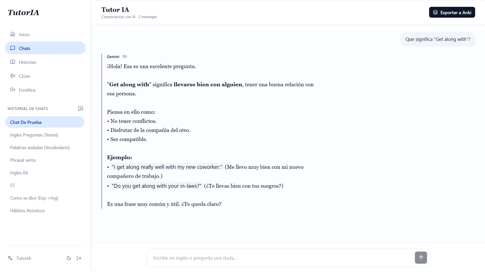
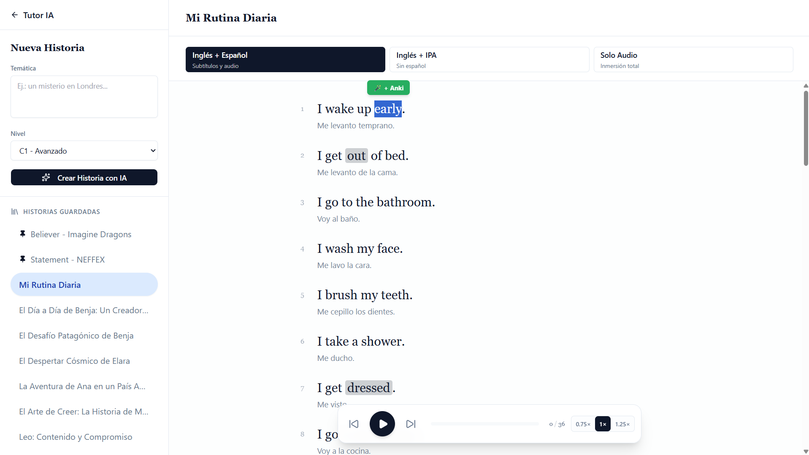
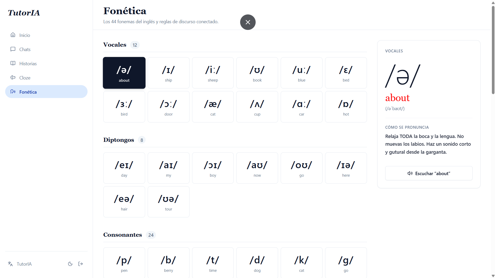
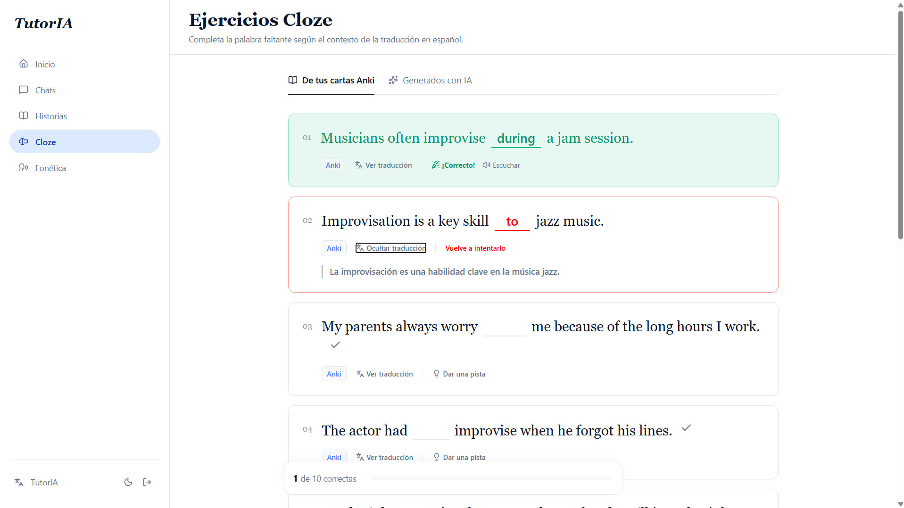
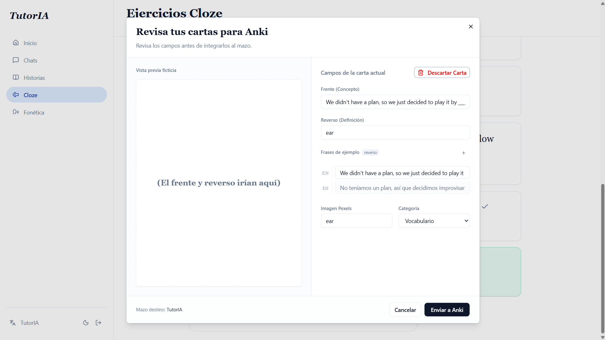

# 🧠 Tutor de Inglés con IA (React + FastAPI)

 

Aplicación web impulsada por IA (Google Gemini) diseñada para el aprendizaje del idioma inglés. El sistema no solo funciona como un chatbot conversacional, sino que integra módulos de fonética, comprensión auditiva mediante historias generadas dinámicamente, y conexión directa con **Anki** para retención a largo plazo.

---

## 🎥 Demostración en Video

[](https://youtu.be/Xd2Hkfm1fEU)

> ☝️ _Haz clic para ver la demostración de uso en video._

---

## Características Principales

- 💬 **Chat como Tutor:** Práctica conversacional impulsada por Gemini, con historial de los chats.

  <p align="center">
    
  </p>

- 📚 **Historias Dinámicas & Audio:** La IA crea historias personalizadas según tu nivel (A1 a C2) y temática solicitada. Incluye 3 modos de práctica: Comprensión (audio + traducción), Adquisición (audio + formato IPA) e Inmersión (solo audio).

  <p align="center">
    
  </p>

- 🗣️ **Fonética:** Aprendizaje de los 44 fonemas del inglés (IPA) y discurso conectado (Connected Speech).

  <p align="center">
    
  </p>

- 🧩 **Ejercicios Cloze:** Relleno de espacios en blanco basados en flashcards generadas por el sistema o por IA, con validación visual y entrega de pistas.

  <p align="center">
    
  </p>

- 🧠 **Sincronización con Anki:** Si utilizas AnkiConnect, la aplicación inyecta automáticamente nuevas palabras y flashcards con audio, imágenes, ejemplos, traducción y formato IPA directamente a tu mazo para repaso espaciado.

  <p align="center">
    
  </p>

- 🎨 **Diseño Responsive & Theme Mode:** Aplicación Adaptada tanto a pantallas de escritorio como dispositivos móviles. Selector de tema claro/oscuro con preferencia el tema del sistema del usuario.

- 🔗 **Autenticación Multi-usuario:** Acceso y control de sesión seguro mediante Firebase Auth.

---

## 🛠️ Stack Tecnológico

**Frontend:**

- React 18 + TS
- Vite
- React Router DOM
- Tailwind CSS

**Backend:**

- Python 3 + FastAPI
- Google GenAI SDK (Gemini AI)
- SQLite
- Firebase Admin (Autenticación)
- Edge-TTS (Voces Neurales)

---

## 🚀 Instalación y Configuración Local

Sigue estos pasos para levantar el entorno de desarrollo en tu máquina local.

### 1. Clonar el repositorio

```bash
git clone https://github.com/BenjaAle/TutorIA_React_FastAPI.git
cd TutorIA_React_FastAPI
```

### 2. Configurar el Backend (FastAPI)

Abre una terminal en la carpeta `/backend`:

```bash
cd backend
```

Crear ambiente virtual

```bash
python -m venv venv
```

Activar ambiente virtual

```bash
# En Windows:
venv\Scripts\activate

# En Mac/Linux:
source venv/bin/activate
```

Instalar dependencias

```bash
pip install requeriments.txt
```

#### Variables de Entorno y Credenciales

Dentro de la carpeta `backend/`, crea un archivo llamado `.env` e inserta tus API Keys:

```env
GEMINI_API_KEY=tu_api_key_de_google_ai_studio
PEXELS_API_KEY=tu_api_key_de_pexels
```

Además, necesitas el archivo de credenciales de servicio de tu proyecto en Firebase. Descárgalo desde la consola de Firebase y guárdalo en la carpeta `backend/` con el nombre exacto de: `credenciales_firebase.json`.

#### Levantar el Servidor Backend

```bash
uvicorn main:app --reload
```

El servidor backend estará corriendo en `http://localhost:8000`.

### 3. Configurar el Frontend (React)

Abre otra terminal en la carpeta `/frontend`:

```bash
cd frontend

# Instalar dependencias de Node
npm install

# Iniciar servidor de desarrollo
npm run dev
```

La aplicación web estará corriendo en `http://localhost:5173`.

### 4. Configurar Anki

Si quieres extraer vocabulario y que se guarde en Anki:

1. Instala **Anki** en tu computadora e inícialo.
2. Instala el complemento **AnkiConnect** (Código: `2055492159`).
3. En la configuración de AnkiConnect, asegúrate de permitir peticiones CORS desde `http://localhost:5173`.
4. Crea un mazo en tu Anki llamado **`Ingles_IA`** con tipo de nota **`Basic`** (o cambia los nombres en el archivo `config.py` del backend para que coincidan con tu mazo actual).

---

Hecho por Benjamín - ¡Happy Learning!
